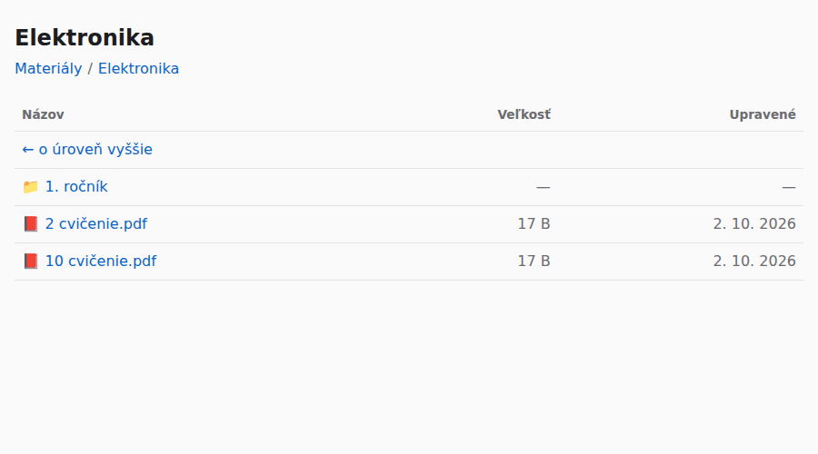

# materialy.stemlab.sk

Verejný prehliadač žiackych materiálov. Beží priamo na Raspberry Pi v nginx a von ho
sprístupňuje existujúci Cloudflare tunel.

```
žiak → materialy.stemlab.sk → Cloudflare tunel → nginx na Pi (127.0.0.1:8080) → /home/admin/materialy
```



- **Pridať materiál = skopírovať súbor do `/home/admin/materialy`.** Na webe je hneď.
  Podzložky sa zobrazia ako zložky.
- **Žiaci iba čítajú.** Server prijíma len GET/HEAD a nič sa nedá nahrať ani zmazať.
- Súbory a zložky začínajúce bodkou (`.poznamky`, `.koncepty/`) sú skryté.
- nginx počúva iba na `127.0.0.1`, takže sa k nemu dostane len tunel.

## Inštalácia (jednorazovo)

Na Raspberry Pi:

```bash
git clone https://github.com/mirecky/stemlab_web.git
cd stemlab_web/materialy
sudo ./install.sh                  # zložka /home/admin/materialy
# alebo: sudo ./install.sh /ina/cesta
curl -I http://127.0.0.1:8080/     # má vrátiť 200 OK
```

Skript:
- nakopíruje stránku prehliadača do `/var/www/materialy-ui`,
- pridá nginx stránku `/etc/nginx/sites-available/materialy` a zapne ju,
- nastaví práva, aby nginx (`www-data`) mohol zložku čítať. Na domovskej zložke pridá iba
  právo prechodu (`o+x`), takže ostatné súbory v `/home/admin` zostanú nečitateľné,
- skontroluje konfiguráciu (`nginx -t`) a načíta ju znova. Hlavný web stemlab.sk sa nemení.

Potom v **Cloudflare dashboarde**:
**Zero Trust → Networks → Tunnels →** váš tunel **→ Edit → Public Hostname → Add a public hostname**

| Pole | Hodnota |
|---|---|
| Subdomain | `materialy` |
| Domain | `stemlab.sk` |
| Service type | `HTTP` |
| URL | `localhost:8080` |

Uložte. Cloudflare sám vytvorí DNS záznam a o chvíľu funguje `https://materialy.stemlab.sk`.

> Ak `cloudflared` beží v Dockeri, `localhost` neukazuje na Pi. Vtedy zadajte IP adresu Pi
> a v `/etc/nginx/sites-available/materialy` zmeňte `listen 127.0.0.1:8080` na `listen 8080`.

## Presun materiálov z MEGA

Na Pi:

```bash
sudo apt install megatools
megadl --path /home/admin/materialy 'https://mega.nz/folder/...'
chmod -R o+rX /home/admin/materialy
```

Alebo zložku stiahnite na mega.nz ako ZIP a rozbaľte ju do `/home/admin/materialy`.

## Ako nahrávať nové materiály

Ľubovoľným spôsobom, ktorým sa dostanete na disk Pi:
- `scp subor.pdf admin@raspberrypi:materialy/Elektronika/`
- cez SFTP (WinSCP, FileZilla, Cyberduck) priamo do `materialy`
- zo sieťového disku (Samba), ak ho máte nastavený

Ak nginx nejaký súbor nezobrazí (chyba 403), chýbajú mu práva na čítanie:
`chmod -R o+rX /home/admin/materialy`.

## Súbory

- `nginx/materialy.conf`: nginx server blok. Cesty doplní `install.sh`.
- `www/index.html`: stránka prehliadača. Obsah zložky si načíta z `/_zoznam/…`
  (nginx `autoindex` v JSON formáte).
- `install.sh`: inštalácia a aktualizácia. Po úprave stačí spustiť znova.
